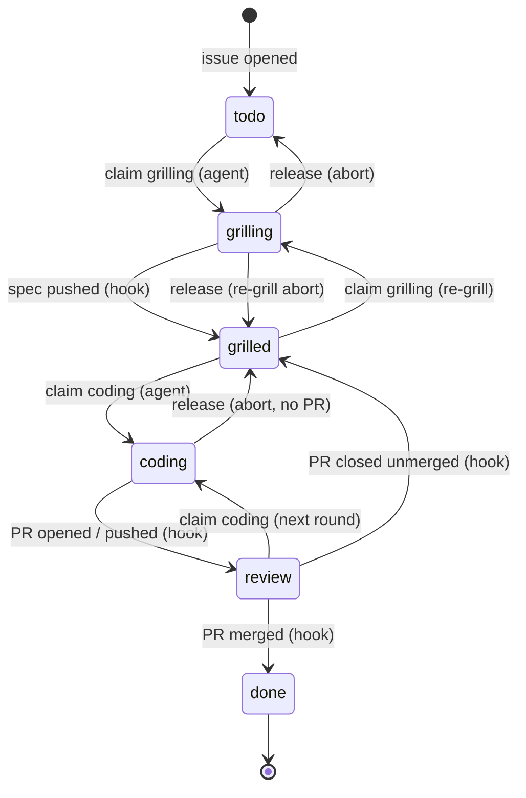

# whackagent on GitHub

How the GitHub backlog provider (`backlog.provider: github`) plugs into the whole whackagent workflow: what lives where, who moves a ticket from one state to the next, and what each command does on GitHub.

With the default `local` provider, the backlog is a Markdown file and one agent works on one checkout. The GitHub provider moves the backlog to a **GitHub Project**, so several agents, in several worktrees or on several machines, share one board without ever working the same ticket at the same time. The skills don't change: they speak the provider contract (`providers/CONTRACT.md`), and the provider maps it onto GitHub.

For the script-level details (every verb, every field mapping, setup internals), see [`providers/github/README.md`](providers/github/README.md).

## The one rule

**Agents take tickets. The repo moves them.**

An agent never writes "this is grilled", "this is in review" or "this is done" on the board. It only *claims* a ticket (a lock) before working on it. Every other state change comes from something that really happened in the repo — a spec pushed, a PR opened, a PR merged — and is applied by a GitHub Actions workflow. So the board always says what the code says, not what an agent believes.

## One board, any work loop

The board is constrained; the way each developer works behind it is not. One dev may run whackagent's skills, another Codex or Cursor, another a different Claude skill or plain git. They all share the board through one file installed in the project: **`BOARD.md`**.

- `BOARD.md` is the contract: the states, what moves each one, how to claim and release, what a PR must carry, the merge style, sprints, milestones and dependencies. It is written for any agent and any human, names no whackagent command, and wins over any skill's own habits.
- `/wa-setup` installs it in one PR together with everything it relies on: a copy of the board CLI at `.github/board/wa-backlog` (so an agent without the plugin runs the same commands), a short pointer block in `AGENTS.md`, `CLAUDE.md`, and the Copilot and Cursor instruction files when present (so every agent reads `BOARD.md` before touching an issue), and three board sections appended to the PR template (`## Ticket`, `## Acceptance criteria`, `## Status`).
- A spec can live in the issue body: a non-empty `## Acceptance criteria` section, written in one edit by someone who can push to the repo, moves the ticket to `grilled`. Criteria from anyone else are reported and wait for a maintainer's edit, so an outsider's text never becomes a spec an agent codes unattended. whackagent's task file on the ticket branch still counts too.
- A PR belongs to the one issue it links (Development link or `Closes #n`), whatever its branch is called, so cloud agents that name their own branches still move the board.
- Each loop may stop wherever its developer likes: local commits, a pushed branch, a draft PR or a ready PR. The board follows: until a PR opens, the ticket stays in `coding` under its claim (nobody else can test that work yet); a draft or ready PR moves it to `review`. A claim left with no push for `WA_STALE_AFTER_HOURS` (default 24) gets a comment on the ticket.
- Merging is a human's decision: on GitHub, or by asking their agent to merge that PR (squash, checks green, never an admin override).
- Breaking the contract is **reported, never repaired**: a scheduled run of the board workflow comments on any ticket whose card disagrees with the repository, and a push to a ticket PR without a claim gets a comment on the PR.
- Every board file carries the same `board-contract` version stamp. The CLI warns when the project's `BOARD.md` and the script disagree; `/wa-setup backlog` refreshes them all in one PR.

## What lives where

| Thing | Where on GitHub |
| --- | --- |
| Ticket | a repo **issue**. Its number is the ticket id (`#12`). Every issue is a ticket unless labeled `wa-ignore`. |
| Title, summary | issue title, first line of the issue body |
| State | Project `Status` field (the board columns) |
| Priority | card order on the Project (top = next) |
| Size | Project `Size` field: `quickwin`, `medium`, `large` |
| Sprint | a parent issue labeled `wa-sprint`; the sprint name is its title in kebab-case (`AI setup` → `ai-setup`); its tickets are its **sub-issues** (GitHub shows a progress bar) |
| Milestone | the repo's GitHub milestones |
| Dependencies | issue **Relationships** ("blocked by") |
| Spec | the task file `{tasks}/<n>-<slug>.md`, **on the ticket branch**, merged with the code |
| Ticket branch | `wa/<n>-<slug>`, created with `gh issue develop` so it shows under the issue's **Development** panel |
| Change | one PR per ticket, from the ticket branch |
| Lock | a git ref `refs/wa-claims/<n>/<phase>` |
| Reservation | issue **assignees**: assigned to another account = no agent of yours may claim it |

There is no local mirror and no `BACKLOG.md`. The task file carries only whackagent's own data (`issue:`, `phase:`, `wiki:`, `note:`, `created:`, plus the optional `type:` and `ported-from:` / `lands:` for tracks) plus the spec sections; title, state, size, sprint and milestone live on GitHub only.

The machinery is three pieces:

- **`wa-backlog`** (`providers/github/wa-backlog`): a Python script (stdlib + `gh`) that implements every contract verb. Skills call it for every backlog read or write.
- **`whackagent-board.yml`**: the hooks workflow, installed in the project's `.github/workflows/`. It reacts to issue, push and PR events and moves the board, and once a day on weekdays runs a report-only check of the board against the repository. The project file is a small caller: the logic is the reusable workflow `rlatapy-luna/whackagent/.github/workflows/board.yml@hooks-v2`, and each whackagent release moves that tag, so every project runs the new logic without a PR. The caller only changes when its triggers, permissions or secret do.
- **Repo variables** (`WA_PROJECT_NUMBER`, `WA_STATES`, `WA_BRANCH_PREFIX`, …) shared by the script and the workflow, plus the **`WA_PROJECT_TOKEN`** secret, a classic PAT with `project` + `repo` scopes. The secret is needed because the default Actions token can't write to Projects v2. Mind its reach: a `repo`-scoped token opens every repository its account can, and anyone with write access to this repo can read the secret from a workflow. Create it on a dedicated bot account that only belongs to this repo and Project.

## The six states



| State | Meaning | Entered by |
| --- | --- | --- |
| `todo` | the ticket exists, not grilled yet | issue opened, by `/wa-task` or by hand |
| `grilling` | **locked**: one agent is grilling it | agent `claim <n> grilling` |
| `grilled` | spec written, ready to code | hook: ticket branch pushed with a task file holding non-empty `## Acceptance criteria` |
| `coding` | **locked, short-lived**: one agent is working a round right now | agent `claim <n> coding` |
| `review` | a PR is open; humans are on turn | hook: PR opened, or an agent round pushed to it |
| `done` | the change landed | hook: PR merged, issue closed, run report from the PR body posted on it |

Two things to keep in mind:

- **`coding` never waits for a human.** It means "an agent is working right now". Every round ends with a push, the push moves the ticket to `review`, and the lock goes away. Nothing sits in `coding` overnight.
- **`review` has two flavors**, told apart by the PR: a **draft** PR means *your turn to test*, a **ready** PR means *your turn to merge*.

The finer whackagent lifecycle (`in-progress` → `review` → `validated`) still exists, but in the task file's `phase:` field, pushed with each round. Board `review` = PR open; `phase: review` = coded, verifier not run yet; `phase: validated` = verifier passed. `wa-backlog list` and `get` read it back from the ticket branch (`phase` on `review` rows), so the dashboard and the pane know which turn is yours.

### Who's on turn

| Board | Phase | PR | You | Next |
| --- | --- | --- | --- | --- |
| `coding` | `in-progress` | | nothing, an agent is working | wait |
| `review` | `review` | draft | test it | `/wa-feedback` with notes, or `/wa-validate`, which marks the PR ready when clean |
| `review` | `validated` | ready | test, then merge | merge on GitHub, or `/wa-close`, which merges on your yes; the hook sets `done` |

A ticket reaches a ready PR one of two ways, both with the wiki synced: attended, through a clean `/wa-validate`; or straight from `/wa-autopilot` when the verifier came back clean. Findings left open keep the PR draft. The local provider uses the same split: `status: in-progress` is `coding`, `status: review` and `validated` are `review`.

## Claims (locks)

Before an agent grills or codes a ticket, it runs `wa-backlog claim <n> grilling|coding`.

- The lock is a git ref, `refs/wa-claims/<n>/<phase>`, pointing at a parentless commit (on a one-file `CLAIM` tree) whose message names the agent (`agent: <host>:<worktree>`, overridable with `WA_AGENT`) and the time.
- GitHub refuses to create a ref that already exists, server-side. When N agents claim the same ticket at the same moment, exactly one wins (tested with six).
- Exit codes are part of the flow: **0** = won, **3** = taken (the script prints who holds it), **4** = wrong state (`grilling` needs `todo`, or `grilled` for a re-grill; `coding` needs `grilled` or `review`; closed issues and columns outside the six states are never claimable). A loser never retries and never steals; it moves on to the next ticket or tells you who holds it.
- **Assign yourself to reserve a ticket.** A ticket assigned to another GitHub account than the one `gh` runs as is `reserved`: `claim` refuses it with exit 3, naming the assignee. Unassigned tickets and tickets assigned to you stay claimable. So a dev who wants a ticket for themselves (or for their own agents) assigns it on GitHub, and nobody else's agent will take it. Claiming does the same thing for you: the winning `claim` assigns the account it runs as, so a ticket your agent grilled stays yours through coding and review, and the hooks never unassign it. An aborted claim (`release`) removes the assignment only if that claim made it; one you made by hand stays. Agents never unassign anyone else. `/wa-board` shows reserved tickets with `👤 @login` and never suggests them; `/wa-autopilot` skips them.
- Each claim and release leaves a trail comment on the issue (`🔒 coding — host:path · time`, `🔓 coding released, back to grilled — reason`).

Locks don't expire, because grilling is interactive and you might answer a question two days later. They're dropped by the hooks on the next real transition, or by an explicit `release` when an agent aborts. `wa-backlog claims` flags a lock as **stale** when nothing was pushed for `WA_STALE_AFTER_HOURS` (24 by default); `/wa-board` shows stale locks, the daily board check comments on the ticket, and only you clear them, with `/wa-task release <n>`.

## The agent round

Every command that touches a ticket's code (`/wa-code`, `/wa-feedback`, `/wa-validate`, `/wa-close`, `/wa-autopilot`) works as one **round**:

1. `claim <n> coding` (from `grilled`, or from `review` for a later round).
2. Work on the ticket branch.
3. Commit the code **and** the task file (`phase:`, notes, review, verification), with your configured author identity, never as Claude.
4. Push. The first delivery opens a **draft PR**; later rounds push to it.
5. The hook sees the PR `opened` or `synchronize` event, sets `review`, and deletes the claim.

Rules that come with it:

- **No push mid-round.** A push to a branch with an open PR ends the round, so the agent pushes once, at the end.
- **Nothing to push?** The agent releases the claim itself: `--reset-to review` if a PR is open, `--reset-to grilled` otherwise.
- **Conflicting PR = no hook.** GitHub doesn't run `pull_request` workflows while a PR conflicts with its base, so the push moves nothing. After each push the agent checks `mergeable`; on `CONFLICTING` it rebases the ticket's own commits onto the PR base, resolves mechanical conflicts (stops and asks on logic), rebuilds, runs the tests, and force-pushes with lease.

### The PR

- **Opened as a draft**, base = the branch the ticket forked from (sprint branch, else `close.target`). Title, labels, assignees and the PR template come from the `pr:` config block (see the README's *Pull requests*). On top of `pr.labels`, the PR always gets at least one of the repo's own labels that fits the change (bug, feature, docs, area); labels are never created. whackagent's part of the body (summary, `Closes #<n>`, the acceptance criteria as a checklist and a status line such as `Draft — verifier not run yet. Test, then /wa-feedback · /wa-validate.`) sits in a marked block after the filled template.
- **Linked by the hook**: the body says `Closes #<n>`, and the hook adds the Development link from it (or from the `wa/<n>-…` branch name), whatever the base. GitHub alone links only PRs onto the default branch, so sprint and stacked PRs would stay unlinked. PRs carry no milestone: the linked ticket has it. `wa-backlog link-pr` remains as a repair command.
- **Body refreshed every round** from the task file: the marked block is rewritten (current summary, a `Changes` list with one user-visible change per line, current criteria, `- [x]` only for criteria a round actually proved, numbered manual test steps from launch to the feature with each expected result, a status line saying what's still owed), and template sections are touched only where the round changed what they say. Text a human added stays. A PR body describing superseded behavior is a lying PR.
- **Assignees**: the PR is always assigned to you (`@me`), plus anyone in `pr.assignees`.
- **Reviewers** (`pr.reviewers`) are requested when the PR goes ready, at `/wa-validate` or on an autopilot ready PR, never on a draft.
- **Screenshots**, when the diff changes UI: taken once at `/wa-validate` with `pr.screenshots: validation` (new screens in a row, changed screens in a Before | After table), or after every coding round with `each_round` (the behavior when the key is missing), or never with `off`. They go into a `## Screenshots` section that only `wa-backlog screenshots` rewrites, uploaded with `gh pr edit --attach` (gh 2.102 or later), else the `gh image` extension (`drogers0/gh-image`). When neither can upload (older `gh` without the extension, or no upload token, common on org repos with SAML SSO), the agent uploads them through the browser instead, via a PR comment box it never posts, and hands the resulting links to `wa-backlog screenshots`. Images are never pushed to a branch.

## Command by command

### `/wa-setup`

Asked early: files or GitHub Project. Choosing GitHub:

- creates a Project, copies your organization's Project template when it has one (keeping its views and workflows), or adopts an existing one (`wa-backlog provision`, with `--template` for the copy). A new board (no template) gets exactly the six state columns in lifecycle order, without GitHub's default `In Progress`. Existing columns are never rewritten unless you agree: missing state options are added, or states are mapped onto your existing column names, and `--prune-status` drops the extra columns no card sits on. A `Size` field is added if missing, and the repo variables are written.
- installs `whackagent-board.yml` **through a PR** (never a direct push to the default branch). The hooks are live once it's merged.
- walks you through the `WA_PROJECT_TOKEN` secret: a token link, then `! pbpaste | gh secret set WA_PROJECT_TOKEN -R <repo>` so the token never appears in the chat.
- forces `branch.per_task: true` and `close.strategy: pr`, and drops the `{backlog}` file.
- can import open issues as `todo`, migrate a local backlog, and run a smoke test (create → claim → release → close).

### `/wa-task` — create

`wa-backlog create` opens an issue in `todo`, at the **bottom** of the board, in the highest open milestone (by version order of titles), with your idea or spec excerpt as the issue body. Dependencies become issue relationships (`wa-backlog depend`). No claim, no branch, no task file yet: grilling creates those.

Prioritization is **never automatic** under GitHub, because the board order is shared with humans and other agents. Only `/wa-task` with no argument proposes a new order, and it's applied (`wa-backlog move`) on your yes. Canceling a ticket = closing the issue as "not planned", on your yes.

### `/wa-grill #12`

1. `claim 12 grilling`.
2. Creates the ticket branch **linked to the issue** right away: `gh issue develop 12 --name wa/12-<slug> --base <fork point>`. Only branches GitHub creates can be linked; a plain `git checkout -b` plus push can never be linked afterwards.
3. Grills you, writes `{tasks}/12-<slug>.md` with non-empty acceptance criteria. Dependencies found while grilling become issue relationships.
4. Commits the task file (`task: grill #12 <slug>`) and pushes, once, at the end.
5. The hook sees the spec on the branch and moves the ticket to `grilled`, dropping the grilling lock.

Abort → `release --reset-to todo`, and the empty remote branch is deleted. **Re-grill** (a `grilled` ticket whose scope changed, on your yes) claims `grilling` from `grilled`, checks out the existing branch, rewrites the spec and pushes it; the hook moves the ticket back to `grilled`. Aborting a re-grill releases back to `grilled` and keeps the branch. A re-grill and a `/wa-code` claiming the same ticket at once never both win. A split → the parent is released and becomes the sprint root (`split`: label `wa-sprint`, off the board, number, history and milestone kept; sprint name = its title in kebab-case), and the children become new tickets in its milestone, as its sub-issues. A parent already in a sprint can't become one: its children join that sprint and it is closed with a comment linking them.

### `/wa-code #12`

Without an argument, it picks the top unclaimed `grilled` ticket. A ticket with an open blocker in its sprint or track is never coded from the base (wait, or let `/wa-autopilot` stack it); an unrelated open blocker gets a warning, and on your yes the PR says `Blocked by #<x>: merge order is yours`. It claims `coding`, checks out the existing ticket branch (never creates a new one: the spec lives there), and runs the normal pipeline. Once the task is broken into bricks, they're posted as one issue comment, one line per brick (a later round that re-plans posts a new comment; the issue body is never edited). The round ends with commit, push and a draft PR; the hook moves the ticket to `review`. The first push of a ticket asks for a one-line confirmation; later rounds push without asking.

### `/wa-feedback #12 <notes>`

Claims `coding` from `review`. Its input is your notes **plus the PR's review comments**, triaged the same way. A PR already marked ready is turned back into a draft first, so nobody merges code that is moving. The round ends with a push and a body refresh; the ticket goes back to `review`, and the hook comments on the ticket and on the PR with a permalink to the new `## Feedback` round in the task file (what you asked, triage, what changed, verdicts). GitHub embeds those lines as a snippet; the task file stays the source of truth.

### `/wa-validate #12`

Claims `coding` from `review`, runs the project tools and the verifier over the ticket's whole diff, and autofixes. When the verdict is clean, the same round gets the PR ready to merge:

1. Syncs the wiki and commits it with the task file (`phase: validated`, `## Review`) and the fixes, so docs ride in the same PR.
2. When the PR base moved, rebases the ticket's own commits onto it, then rebuilds and reruns the tests.
3. When the diff changes UI and `pr.screenshots` is `validation`, shoots the touched screens: a new screen as is, a changed screen as a before/after pair, the before side built from the ticket's fork point in a temporary worktree. A later validation re-shoots only the screens whose code moved since the recorded commit.
4. Pushes (with lease after a rebase), refreshes the body, uploads the screenshots, and runs `gh pr ready`, requesting `pr.reviewers`. When autofix changed code since your test, the status line names the files to retest.

Findings left open → the round still pushes, but the PR stays draft and the status line lists them. Either way the hook moves the ticket back to `review` and drops the claim. `validated` is internal to whackagent: the board never shows it.

### `/wa-close #12`

Merges the ready PR for you, so you don't have to open GitHub. Merging there yourself is just as good: the hook sets `done` either way. A draft PR is sent back to `/wa-validate`.

1. Checks the PR can merge: checks green (or waits for pending ones), required reviews in, base not another ticket's open branch. A conflicting PR adds a rebase of the ticket's own commits to the plan. Criteria still unchecked in the body are named.
2. Shows the plan (squash merge, base, branch and worktree cleanup) and waits for your yes, every time.
3. Claims `coding` so no other round pushes meanwhile, then runs `wa-backlog merge <pr>`: a squash merge (a merge commit for a track landing) through GitHub's async merge API, the only one that accepts stacked PRs. Never `--admin`: when GitHub refuses, the claim is released back to `review` with the reason.
4. The hook sets `done`, closes the issue and drops the claim. Locally, the worktree and branch go away.
5. When that was the sprint's last ticket, it offers the sprint PR, and merging it (merge commit), as a second yes.

### `/wa-autopilot`

Several autopilots, on several machines, can run on one board at once; claims keep them apart.

- Scope = unclaimed `grilled` tickets in board order, or a sprint, a milestone or a list of tickets.
- A ticket you name (`/wa-autopilot 12`) runs from whatever state it's in and does only what's left: a `todo` ticket is grilled unattended first, a draft PR in review is validated, a validated draft is refreshed (rebase + checks) and marked ready, a ready PR is kept mergeable. Sprint and milestone batches still take only `grilled` tickets.
- Each ticket is claimed just before its wave starts, not the whole batch up front, so later tickets stay free for other agents. A ticket someone else holds is skipped.
- Open PRs are checked before planning: a ticket touching the same files as an open PR gets a merge-conflict warning in the plan.
- Each ticket gets a worktree on its existing branch, and its bricks comment right after its claim.
- Delivery: verifier clean → **ready PR** with checked criteria (*test, then merge*); findings left open → **draft PR**. A blocked ticket is released back to `grilled` with the blocking question as the reason, so the question lands on the issue.
- **AFK mode** (`/wa-autopilot afk`) also grills `todo` tickets unattended, answering with its own recommendations tagged `(autopilot assumption)`, and stacks dependent tickets without a depth limit.
- **Test branch** (`branch.test_branch`): at the end of the run, the tickets in `review` on each base it touched (two or more) are merged from `origin/<ticket branch>` into a local `wa-test/<base>` branch, so you test them in one launch. The same rebuild follows every `/wa-code`, `/wa-feedback` and `/wa-validate` round, and `/wa-close` rebuilds or deletes it after the merge. It is never pushed, so the board, the hooks and your teammates never see it; you still merge ticket by ticket.

### `/wa-board`

Reads `wa-backlog list`, `milestones` and `claims` instead of a file. On top of the usual dashboard it shows who holds which lock, **stale locks** (with the `/wa-task release` to run), Project draft items (not tickets yet: convert them to issues), and the `review` section split into 🧪 draft (your test) and 🔀 ready (your merge). Issues closed as not planned show under 🚫 Canceled, apart from 🎉 Done. It never suggests a ticket someone else holds.

### `/wa-release 0.3.0`

Same flow as with files. Readiness comes from `wa-backlog list --milestone`, and the milestone is closed with `close-milestone` only at the end, on your yes. Release PRs and GitHub releases are run with `gh`, each confirmed separately. The hooks ignore release PRs: they aren't ticket PRs.

## Sprints, milestones, dependencies

- **Sprint** = parent issue (`wa-sprint` label) with the tickets as sub-issues. `set-field <n> sprint <name>` creates the parent on first use; a grill split turns the split ticket itself into the parent. Ticket branches fork off the sprint branch `sprint/<name>`, and ticket PRs target it. When the last ticket lands, `/wa-close` proposes the sprint PR onto `close.target`; merging it closes the parent. A sprint left open after that (the PR declined, tickets closed elsewhere) lands later with `/wa-close <sprint>`: sprint PR if its branch still holds unlanded work, else the parent is closed (asked first). The backlog pane shows such a sprint with a `close` button. Without sprint branches (`WA_SPRINT_PREFIX=none`), the parent closes when its last sub-issue lands.
- **Milestone** = release scope, not a sprint. You create milestones on GitHub. New tickets join the highest open one (version order of titles), so they never grow the scope that's about to ship. The hooks never touch milestones.
- **Track** = long-shot feature on its own long-lived trunk (`branch.tracks: {server: develop_synchro}` in the config, keyed by milestone title). Tickets in that milestone fork from and PR into the track branch, and new tickets never land there by default: `/wa-setup` passes each track to `provision --track`, stored in the `WA_TRACKS` repo variable, so `create` skips it. The hooks need nothing new: track PRs merge like any other, and sync branches (`wa-sync/<track>-<date>`) don't match the ticket prefix. See [Tracks](README.md#tracks).
- **Dependencies** = "blocked by" relationships. A blocker is **related** when it shares the ticket's sprint or track. `/wa-autopilot` makes a ticket wait for a related blocker's wave, or **stacks** it: the dependent PR targets the blocker's branch and `wa-backlog stack <pr> --on <blocker pr>` puts it in a [GitHub stack](https://docs.github.com/en/pull-requests/get-started/about-stacked-prs) on top of the blocker. A chain of dependent tickets becomes one stack. An unrelated blocker (another sprint or track, or none) never stacks: the ticket works from its own base and its PR says `Blocked by #<x>: merge order is yours`.

### Stacked PRs

- **Merging.** The merge box shows the stack map. `gh pr merge` refuses a stacked PR, so `/wa-close` merges through `wa-backlog merge`, one ticket at a time, bottom first: it refuses a PR while one below it is still open. On GitHub you can also merge a PR together with every PR below it, each squashed onto the stack's base, all or nothing. Either way, the PRs above retarget to the stack's base and GitHub rebases them itself, and the hooks mark every merged ticket `done`, landed on the stack's base.
- **Rules and CI** come from the stack's base branch (usually the sprint branch), for every PR in the stack.
- **The stack must stay linear.** GitHub refuses to merge a stack whose upper branch doesn't descend from the one below, even when each PR says it's mergeable. So any agent round that pushes to a lower ticket cascades: it claims each ticket above, rebases its ticket range onto the new branch below and pushes it.
- **Stacks are linear, not trees.** When a blocker already has another PR on top of it, the new PR can't join the stack: it stays chained on the blocker's branch and its body names the merge order. For such chained PRs, provisioning turns on `delete_branch_on_merge`, so merging the blocker deletes its branch and GitHub retargets the PR.

> **Don't delete a chained PR's base branch by hand.** GitHub retargets dependent PRs only when the branch is deleted at merge time. Deleting it later (`git push --delete`, the API) **closes** every PR based on it. Retarget those PRs first.

## Squash merges and the ticket range

PRs are assumed to land squashed. After a parent or stacked ticket is squash-merged, the base no longer contains that ticket's original commits, so `git merge-base` and a plain `git rebase <base>` replay already-landed work and conflict on every commit.

So the agents never diff or rebase from `<base>..HEAD`. They use the **ticket range**: the ticket's own commits, starting at its first task commit: the grill commit (`task: grill #<n> …`), or, when the spec was written in the issue body, the commit that copied it into a task file (`task: spec #<n> …`).

```
start=$(git log --format=%H -E --grep="^task: (grill|spec) #12 " wa/12-login-apple | tail -1)
git diff $start^ wa/12-login-apple           # what the ticket changed
git rebase --onto origin/<base> $start^      # move it onto a new base
```

This works whether or not the project squashes.

Sprint PRs are the exception: a sprint branch lands with a **merge commit, never squashed**. Squashing would flatten every ticket of the sprint into one commit and leave the target without the sprint branch's commits, so the sprint PR body says so, and when you ask the agent to merge it, it runs `gh pr merge <pr> --merge`. A track landing follows the same rule.

## Gotchas

- **The workflow must be on the default branch *and* on ticket branches.** `issues` events run the default branch's copy; `push` and `pull_request` events run the pushed ref's copy. Branches forked after the setup PR merged carry it.
- **Custom `branch.prefix`** → edit the workflow's `branches:` filter to match.
- **`list` lags 1–3 minutes** behind new tickets (GitHub indexing). `get` and `claim` read the issue directly and are always current.
- **A late hook is waited for, never helped.** If a state doesn't move, the agent re-reads once, then points you at the Actions run. It never sets the state itself.
- **Hooks version gate.** Before a round that pushes code, an agent reads the workflow's `template version` on the PR base. Below 14 (a full copy of the logic rather than the small caller), or no workflow at all, it stops before claiming and tells you to upgrade with `/wa-setup backlog`: older hooks don't end agent rounds, so the ticket would stay in `coding`.
- **Extra columns** (`Blocked`, `In Progress`) are kept as they are and ignored: tickets there are never claimed.
- **GitHub's built-in Project workflow "Pull request linked to issue"** moves a card to its own column the moment a PR links the issue. `/wa-setup` asks you to switch it off (Project → ⋯ → Workflows). Left on, the hooks still take the card back while a `coding` claim is held, and for about 30 seconds after they add a PR's link themselves. A move later than that stays until someone fixes it.
- **Organization Projects** work with the same PAT scopes. A GitHub App path, not tied to one person's token, isn't built yet.
