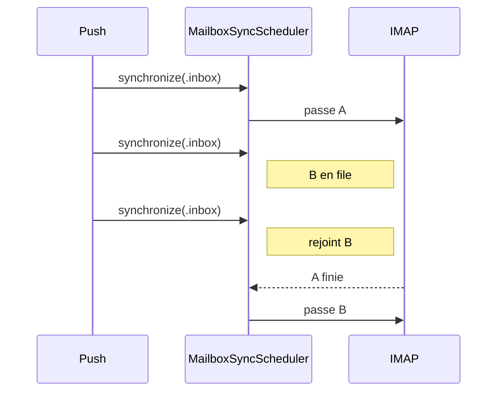

# How it works

PR section that explains the mechanisms behind the diff, for a reviewer who never saw the task. **voice**, **pr** apply.

## When

- Mechanism to explain: new flow, state, business rule, data model, cache or concurrency, non-obvious fix.
- `Changes` says it all (copy, style, rename, config) → no section.
- Sprint PR → from the sprint diff, for the whole sprint.

## Shape

`## How it works` heading, right after `## To test`, even if the template lacks it. Under it, one collapsed block per mechanism:

```md
<details>
<summary><b>Une synchro à la fois par Compte</b></summary>

…

</details>
```

- ≤ 3 blocks, code execution order. One block = one mechanism the reviewer needs to read the diff.
- Known bug or limit → own block only with an issue: `Bug connu #283 : un état lu envoyé en trop`. Else `## Notes`.
- **Summary** = title alone, ≤ 6 words, a fact about behavior: `Réception synchronisée en premier`, never `Ordre de synchro`. No sentence, no type. HTML only (`<b>`, `<code>`): GitHub ignores markdown there.

## Block

Labels in `pr_language`, this order:

1. **Before** / **Now**: one or two sentences each. Nothing before → **Problem**: what was missing.
   - Test block → **Situation**, **Risk**, **Expected** bullets instead.
2. Diagram + caption (**Diagram**).
3. `<details><summary>Code</summary>`: code (**Code**), then **Read**: entry function → next → next.

## Code

- Mechanism → pseudo-code in the language's syntax, real type and function names.
- Contract (type, enum, signature, model) → real code from the diff, cut, ≤ 15 lines, doc comments removed.
- Same function never twice in two forms.
- `if / else` over `??` or chained `guard`.
- Comments:
  - Intent, never the effect the name says: `// confirmation perdue : l'app croit à un échec`, not `// envoie UID MOVE`.
  - Each branch: when it happens, in usage terms: `// Trois push = une passe`.
  - No unknown name: every type, property or method in a condition → caption, or replaced by a plain-named expression.
  - No undefined jargon (`rendu`, `porte`, `replay`).
- Test → each `#expect` comments what it proves.

## Diagram

- Mermaid, when a picture beats the code: several components, order in time, branches. Code shows it all → none.
- `flowchart LR` → steps, branches. `sequenceDiagram` → exchanges over time. `stateDiagram-v2` → only ≥ 3 states in the code.
- ≤ 8 nodes, arrow labels ≤ 4 words, detail → `Note`.
- Node = name alone: type or glossary term. Never a definition in it.
- Categories → named `subgraph` (`Code de prod`, `Faux, pour le test`). Never a style to explain.
- **Caption** right under: one bullet per name of the diagram and the code. Glossary terms skipped. Code-only name → `(dans le code)`. No diagram → same caption under the code.
  ```md
  - <sub>`ScriptedIMAPGate` : retient la réponse du serveur à une commande IMAP.</sub>
  ```

## Style

Full sentences, short: not the terminal telegraph.

- One sentence, one fact. Cause needed → same sentence.
- No `on` / `we`: concrete subject (type, user, app, server).
- No guessable justification (`Inutile de…`).
- No emphasis words (`pile`, `bien`, `déjà`, `justement`, `une fois pour toutes`).
- Condition → `<case> : <result>`. No rhetorical question.

## Truth

From the diff vs `merge-base` + `## Context / Decisions`. Link unsure (who calls what) → read the caller, never guess.

## Example

````md
## Fonctionnement

<details>
<summary><b>Une synchro à la fois par Compte</b></summary>

**Avant** : synchro complète, pull to refresh et push lançaient chacun leur passe. Deux passes pouvaient tourner sur un Compte, avec deux connexions IMAP.

**Maintenant** : `MailboxSyncScheduler` tient une file par Compte. Une passe tourne à la fois.



- <sub>Passe : une synchro d'un Compte (`Pass`), en file ou en cours. Partagée (`isShared`) : plusieurs push la rejoignent.</sub>
- <sub>`MailboxScope` : les Dossiers qu'une passe synchronise. `.inbox` pour le push.</sub>

<details>
<summary>Code</summary>

```swift
func synchronize(_ scope: MailboxScope, of account: Account) async throws {
    let pass: Pass
    if let waiting = waitingPasses[account].last(where: { $0.isShared && $0.scope == scope }) {
        // Passe partagée sur les mêmes Dossiers déjà en file : le push la rejoint. Trois push = une passe.
        pass = waiting
    } else {
        // Sinon : nouvelle passe en fin de file.
        pass = startPass(scope, of: account)
    }
    try await wait(for: pass)                    // l'appelant attend la fin de la passe
}
```

**À lire** : `synchronize` → `startPass` → `finish`.

</details>

</details>
````
